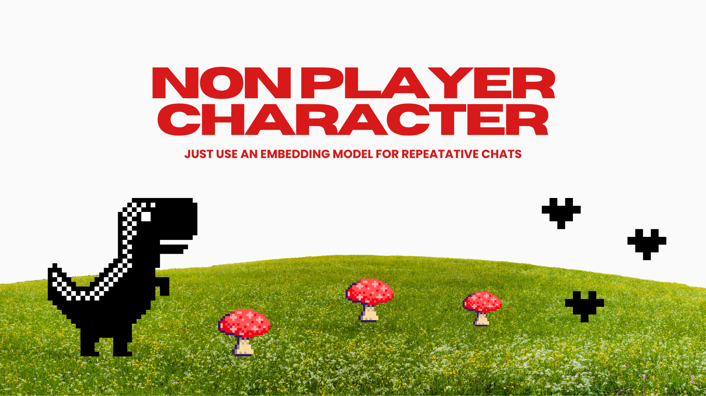

<p align="center">
  
</p>

# NPC

**Just use an embedding model for repetitive chats.**

> **Status: under construction.** This project is an active experiment. Expect rough edges, changing APIs, and results that move as the approach is refined.

## Thesis

Most customer-facing chatbots spend an expensive, slow general-purpose LLM call on every message, even though the bulk of the traffic is the same few hundred questions asked in different words ("where's my bill", "why was I charged twice", "how do I change my plan").

NPC tests a simple idea: **avoid general LLM APIs as much as possible.**

- An LLM is used **once, offline**, to generate a bot: an intent graph, example phrasings, and reply templates.
- At chat time, each message costs **one embedding call**. The message is matched against pre-computed intent example vectors by cosine similarity. No chat-time LLM generation.
- Replies are pre-written templates, with slot filling (name, phone, email, choices) and a contact handoff when the bot can't help directly.
- Below a similarity threshold, the bot uses a fallback reply instead of guessing.

The goal is a bot that is cheap, fast (sub-second), predictable, and unable to hallucinate, because it can only say what it was configured to say.

## How it works

1. **Generate**: an LLM produces an intent catalog (top-level intents, sub-intents, follow-ups), examples per intent, reply templates, and slots from a business brief.
2. **Index**: examples are embedded and stored as vectors (`vectors.json`).
3. **Chat**: embed the incoming message, find the nearest example, apply a small context boost to children of the active intent, and compare against the threshold.
4. **Respond**: render the intent's template, collect slots if needed, show quick-reply chips, and save submissions.

Core logic lives in `src/lib` (Node) and `app/src/bot` (browser/Cloudflare port).

## Early benchmark results

The benchmark compares the embedding classifier (`stealth-01`) against an LLM classifier (`gpt-6-luna`, given the full intent catalog in its prompt) on 974 synthetic customer questions for a fictional telecom ("Lumen Telecom").

| Arm | Accuracy | Right area | False answer (out of scope) | p50 latency | p95 latency |
| --- | --- | --- | --- | --- | --- |
| Embeddings (`stealth-01`) | 58.0% | 84.0% | 34.5% | 303 ms | 749 ms |
| LLM (`gpt-6-luna`) | 74.7% | 93.2% | 10.9% | 3,572 ms | 10,430 ms |

Takeaways so far:

- The embedding approach is roughly **10x faster** and needs no chat-time generation, but it is **noticeably less accurate** than the LLM baseline today.
- It most often lands in the *right area* (84%) while missing the exact intent, which points to near-duplicate intents as a main source of error.
- It is overconfident on out-of-scope questions (34.5% false answers).

Caveats: questions are synthetic, the same model family wrote the intent catalog and competes as a contestant, and the threshold was swept on the same test set. Treat these as a proxy, not a production claim. Full details are in `data/bench/runs/lumen-main/report.md`.

## Future work

- **Improve accuracy** of the embedding path:
  - better and more diverse example generation per intent
  - merging or disambiguating near-duplicate intents
  - per-intent thresholds and a calibrated out-of-scope detector
  - reranking, hybrid lexical + embedding scoring, and better use of conversation context
  - learning from real traffic and flagged misses
- **Fallback LLMs for certain queries**: route only low-confidence, ambiguous, or out-of-scope messages to an LLM, so most traffic stays on the cheap embedding path while hard cases get better answers.
- Evaluate on real conversations rather than synthetic ones.

## Repository layout

```
app/              Astro + Cloudflare site and in-browser chat app
  src/bot/        Chat engine, classifier, slots, templates (browser port)
src/lib/          Node chat engine, bot generation, embeddings, store
scripts/bench/    Benchmark: bot generation, question generation, run, report, charts
bench/brief.json  Business brief used for the benchmark bot
data/             Generated bots, vectors, benchmark sets and runs
public/           Static assets (including the banner)
```

## Getting started

Requires Node >= 22.22.

```bash
# root (generation + benchmark)
npm install
cp .env.local.example .env.local   # then fill in your API keys

# web app
cd app
npm install
npm run dev
```

Benchmark scripts (from the repo root):

```bash
npm run bench:gen-bot      # generate the bot from the brief
npm run bench:questions    # generate test questions
npm run bench:run          # run embedding and LLM arms
npm run bench:report       # write report.md
npm run bench:charts       # render charts (needs Python)
```

Key settings in `.env.local`: `OPENAI_API_KEY`, `OPENAI_EMBED_MODEL`, `INTENT_THRESHOLD` (minimum cosine similarity before falling back), and `CONTEXT_BOOST`.

## License

Not yet specified.
